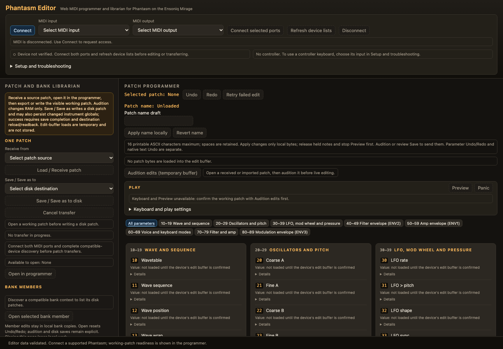

<h1 align="center">
  <picture>
    <source media="(prefers-color-scheme: dark)" srcset="docs/assets/brand/PH-LOGO-003-lockup-yellow.svg">
    
  </picture>
</h1>

<p align="center">
  <strong>A wavetable synthesizer operating system for the Ensoniq Mirage.</strong><br>
  <em>Embrace the glitch!</em>
</p>

Phantasm replaces the Mirage's sampling OS with a wavetable synthesis engine in
the spirit of the PPG Wave and the Prophet VS. Single-cycle 8-bit waves are
scanned under envelope, LFO and velocity control and played through the
Mirage's own analog CEM 3328 filters. Each new note can step through a
programmed list of waves, so a held chord or a repeated note keeps changing.
The lo-fi character of the 8-bit playback path is part of the sound.

Phantasm loads from floppy exactly like the stock OS, in practice from a Gotek
floppy emulator and an `.hfe` disk image. The Mirage's boot ROM is never
touched and Phantasm writes to the disk only when you save, so a bad disk
cannot harm the instrument.

This repository is Phantasm's public home: the documentation, the editor, and
the place to [report problems and give feedback](#feedback-and-support).

> **Current version: 1.2.0** (2026-10-16). See the
> [release notes and downloads](https://github.com/laurielaptop/phantasm-os/releases/latest).
> Chord mode passed on a real Mirage. The glitch sequences and the new wave
> families are confirmed in the emulator and are still to be played on
> hardware, so treat this release as a preview in those areas.

## Main features

- **Eight voices, two oscillators each.** Every voice has its own calibrated
  analog filter, three envelopes and an LFO. Oscillator B is a detuned copy of
  A, white, pink or brown noise, or a copy hard-synced to A.
- **Wave scanning.** A patch carries up to eight wavetables of 1 to 128 waves.
  The wave position moves with the modulation envelope, the LFO, velocity, the
  key, the mod wheel and channel pressure.
- **Per-keypress wave sequencing.** A sequence picks where each note starts in
  its table, in five modes: off, step, per voice, random and LFO. The factory
  disk includes glitch sequences, and every factory patch responds to its
  sequence.
- **Chord keyboard mode.** Hold a chord, let go, and every key plays it.
- **A 512-wave pool on the disk.** 256 factory waves in eight families
  (including the new `organ` and `digital` families, harmonics, voices, bells
  and more), 128 waves of noise, and a
  128-wave user area you fill with your own waves over MIDI Sample Dump.
- **Fixed modulation routes with depth controls.** Filter envelope, velocity,
  key, LFO, pressure and the wave position itself to cutoff; a looping third
  envelope to pitch (A, B or both), resonance, LFO depth or the wave position;
  key-scaled speed on all three envelopes.
- **Poly, mono and unison.** Oldest-first voice stealing, mono with retrigger
  or legato, unison of 1 to 8 voices per key with spread, glide, and a
  per-note "vintage" drift.
- **100 patches per disk**, each with its own tables, sequences and name,
  loaded and saved from the panel or by program change.
- **Front-panel editing on the stock display.** `PARAM` and two digits picks a
  parameter, `VALUE` and two digits sets it, and every edit is heard at once.
- **Full MIDI control.** Velocity, pitch bend, mod wheel, channel pressure,
  sustain, program change, master tune and transpose. 56 of the 66 parameters
  have a CC, and a SysEx protocol lets [Phantasm Editor](#phantasm-editor)
  read and set every parameter and transfer patches.

Not yet built: LFO sync to MIDI clock, keyboard split and layer, and
crossfading between waves.

## Documentation

| Document | What it covers |
|---|---|
| [Quick-start guide](docs/QUICKSTART.md) | Start here. The wavetable ideas in pictures, the panel, a tour of the factory patches and six quick recipes. |
| [Player's manual](docs/MANUAL.md) ([PDF](docs/phantasm-manual.pdf)) | Every control in the order you need it, MIDI, the user area, and what the display codes mean. |
| [MIDI implementation](docs/MIDI-IMPLEMENTATION.md) | Control changes, the SysEx protocol and the Sample Dump receive, for editor, librarian and controller-map authors. |
| [Parameter card](docs/phantasm-param-card.pdf) (PDF) | Every parameter on one printable page. It doubles as the CC chart. |

### What you need

- An Ensoniq Mirage with a [Gotek](https://en.wikipedia.org/wiki/Gotek)
  floppy emulator running FlashFloppy in place of its drive.
- A USB stick holding the Phantasm `.hfe` disk image.
- Optionally, a MIDI keyboard or controller, and a computer with a MIDI
  interface for Phantasm Editor and for sending your own waves.

## Phantasm OS

Copy this .hfe file to your USB device to run on a Gotek floppy emulator.

**[Download phantasm-release.hfe](https://github.com/laurielaptop/phantasm-os/releases/latest/download/phantasm-release.hfe)**

Make a floppy disk image using this .img file

**[Download phantasm-release.img](https://github.com/laurielaptop/phantasm-os/releases/latest/download/phantasm-release.img)**

## Phantasm Editor



Phantasm Editor is a programmer and librarian for Phantasm that runs in your
web browser and talks to the Mirage over Web MIDI.

- **Patch programmer.** Every parameter, grouped as on the instrument, with
  live audition, undo and redo, and help for each control.
- **Librarian.** Receive, open, edit and save any of the 100 disk patches, and
  import or export single patches and whole banks as `.syx` files.
- **Play from the screen.** An on-screen keyboard, or your computer keyboard,
  for auditioning without a controller.
- **Instrument settings.** Read and set master tune and transpose.
- **Safe transfers.** The editor checks that the connected instrument speaks a
  compatible protocol before it changes anything, paces every transfer, and
  never reports an uncertain transfer as a success.

The editor is a single HTML file with nothing to install.

**[Download phantasm-editor.html](https://github.com/laurielaptop/phantasm-os/releases/latest/download/phantasm-editor.html)**

### Using the editor

1. Save `phantasm-editor.html` anywhere on your computer (as HTML, not as a
   web archive).
2. Open it in a browser with Web MIDI SysEx support. Google Chrome is the
   one it has been checked with. Use **File > Open File** or drag the file
   into a window, then wait for **Editor data validated** at the bottom of
   the page.
3. Click **Connect** and allow MIDI and SysEx access when the browser asks.
   The editor asks for nothing until you click.
4. Choose the MIDI input and output connected to the Mirage, then
   **Connect** again.

If your browser will not grant MIDI access to a local file, serve it from
your own computer instead. In the folder that holds the file, run

```bash
python3 -m http.server 8000 --bind 127.0.0.1
```

and open <http://localhost:8000/phantasm-editor.html>.

Edits made in the editor live in the instrument's memory until you save them
to disk, and in the browser only until you close the page: export your work as
`.syx` files to keep it. This editor release (v1.2.0) works with Phantasm 1.2.0 (SysEx
protocol 4.0, schema 1.17). An instrument still on 1.1.0 connects read-only:
update its disk image first. The editor refuses to edit any other
incompatible version.

> **Preview.** The editor is in its own preview: it is tested against a
> simulated instrument; browser/tablet qualification and acceptance on a real
> Mirage remain incomplete. Please
> [report anything that goes wrong](#feedback-and-support).

## Feedback and support

Bug reports, questions and ideas are all welcome as
[GitHub issues](https://github.com/laurielaptop/phantasm-os/issues/new/choose).
Pick the form that fits:

- **[Report a bug](https://github.com/laurielaptop/phantasm-os/issues/new?template=bug_report.yml)**
  in Phantasm or the editor.
- **[Suggest a feature](https://github.com/laurielaptop/phantasm-os/issues/new?template=feature_request.yml)**
  or an improvement.
- **[Report a documentation problem](https://github.com/laurielaptop/phantasm-os/issues/new?template=documentation.yml)**:
  a mistake, something unclear, or something missing.
- **[Ask a question](https://github.com/laurielaptop/phantasm-os/issues/new?template=question.yml)**
  about using Phantasm.

Before opening an issue, please
[search the existing ones](https://github.com/laurielaptop/phantasm-os/issues?q=is%3Aissue)
in case it has already been reported. For a bug, the most useful details are
the Phantasm version the display shows at boot, what you did, what you
expected, and what happened, including any code on the display.

## Legal

Phantasm is an independent project. It is not affiliated with or endorsed by
Ensoniq or its successors. Ensoniq and Mirage are trademarks of their
respective owners.

## Credits and permissions

The Phantasm wordmark and transmission emblem are shown here to identify the
project. See [brand credits and permissions](docs/BRAND.md) for the approved
palette, the usage rules and the status of the artwork's licence.

The original documentation text and diagrams in `docs/` and this README are
licensed under [CC BY 4.0](docs/LICENSE.md), except for the reserved brand
artwork and any third-party material. Phantasm Editor and OS are MIT-licensed; see
[`LICENSE`](LICENSE). These licences do not cover the Phantasm
brand assets.
