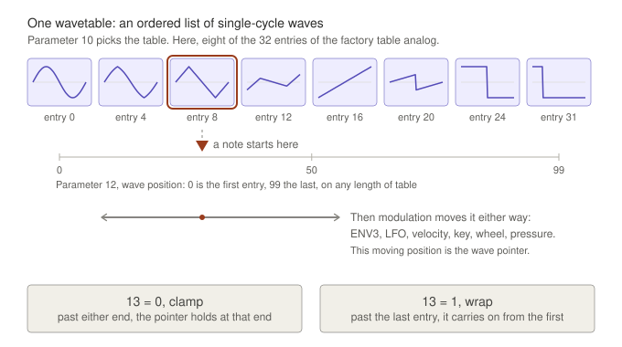
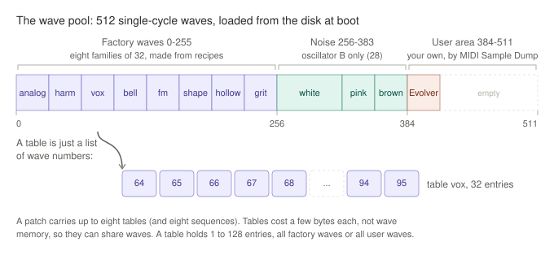
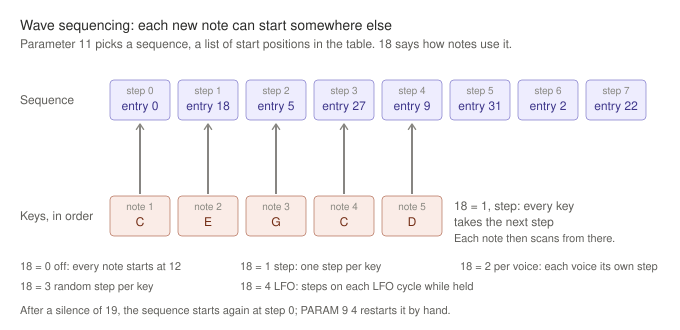
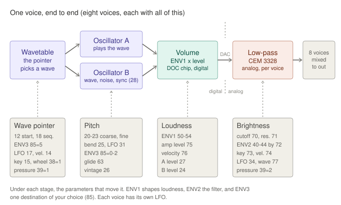
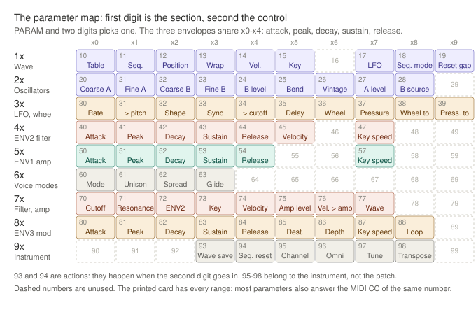

  <a href="../README.md"><picture>
    <source media="(prefers-color-scheme: dark)" srcset="assets/brand/PH-LOGO-003-lockup-yellow.svg">
    
  </picture></a>

<em>Embrace the glitch!</em>

# Phantasm quick start

Phantasm turns an Ensoniq Mirage into an 8-voice wavetable synthesizer. This
guide covers the ideas behind it in a few pictures, then gets you playing and
editing within a few minutes. The [player's manual](MANUAL.md) has the full
detail, and the [printed parameter card](phantasm-param-card.pdf) has every
number on one page.

## 1. Boot it

1. Put the Phantasm `.hfe` image on the Gotek's USB stick, under a short name
   such as `_ptm-phantasm.hfe`. The drive's small display cuts long names
   short, and the underscore sorts the file to the top.
2. Select the image on the Gotek and switch the Mirage on.
3. Wait about **21 seconds**. The display stays quiet while the 512 waves load
   from the disk. When boot finishes, it shows the version number until you
   touch the panel.
4. Play. Patch 00 is loaded. If the keys are silent, send notes from a MIDI
   keyboard, and check the MIDI channel (parameter 95) and omni (96).

A bad disk cannot harm the Mirage. The boot ROM is never touched, and
Phantasm writes to the disk only when you save.

**Change images with the Mirage off.** Waves, instrument settings and the
user-wave save eligibility are loaded at boot. A patch load reads the newly
selected image's patch/palette but keeps the old waves and settings; saves
write the currently selected image. Action 93 does not recheck its layout.
Finish operations and preserve patch edits/settings with SEQ Save and user
waves separately with PARAM 9 3 on the original image. Keep host patch dumps
and Sample Dump source files, then power off, back up the HFE on the computer,
select the intended compatible image and boot it fully before loading or
saving. A reboot loses remaining RAM edits, settings and uploaded waves.
The complete procedure is in [manual section 4](MANUAL.md#changing-gotek-images)
and is **unverified on hardware** for v1.2.0 and v1.2.1. Do not use live
image swapping for transfers. Matching patch-sector versions do not guarantee
matching sounds: v1.2.0 changes factory wave and noise content from v1.1, and
v1.2.1 replaces all 100 factory patches. Keep the
original image as well as individual patch backups.

## 2. The idea: waves, tables and a pointer

A sampler plays a recording. Phantasm plays a **wave**: one cycle of a sound,
256 points long, repeated at the pitch of the key. On its own, a single wave
sounds static. The movement comes from switching between waves while the note
plays.

*PH-ILLUS-005 v001 © 2026 laurielaptop. Used under the
[Phantasm Media Internal Use Licence](assets/LICENSE.md); no reuse rights are
granted outside the Phantasm Projects.*

- A **wavetable** is an ordered list of waves, arranged so that neighbours
  differ a little and the far ends differ a lot. Parameter **10** picks the
  table.
- **Wave position (12)** is where in the table a note starts: 0 is the first
  wave and 99 the last, on a table of any length.
- The **wave pointer** is that position as it moves. ENV3, the LFO, velocity,
  the key, the mod wheel and aftertouch can all push it up or down the table
  while the note sounds. This is wavetable synthesis in the PPG tradition.
- **Wave wrap (13)** decides what happens past the end: clamp (0) or wrap
  round (1).

The pointer jumps from wave to wave with no crossfade. The small steps you
hear on a slow scan, and the 8-bit grain, are part of the instrument's
character rather than faults.

### Where the waves live

The disk carries **512 waves**, all loaded into the Mirage's wave memory at
boot:

| Waves | What they are |
|---|---|
| 0-255 | The factory waves: eight families of 32 (analog shapes, harmonic growth, vocal formants, bells, FM, drawbar organ, hollow and resonant, lo-fi digital), each built from a recipe |
| 256-383 | White, pink and scrape noise, for oscillator B (section 3) |
| 384-511 | The **user area**, for waves of your own, sent by MIDI Sample Dump. The factory disk puts 32 Evolver single cycles at 384-415 and leaves the rest empty |

A table is only a list of wave numbers, so tables are small and can share
waves. Each patch carries its own set of up to eight tables and eight
sequences.

### Wave sequencing

Phantasm adds **per-keypress wave sequencing**. A **sequence (11)** is a list
of start positions. **Sequence mode (18)** decides which one each new note
uses: the next step (1), each voice's own step (2), a random step (3), or the
next step on every LFO cycle while the key is held (4). The sequence picks
where a note starts, and the modulation then scans from that point. A pause
longer than **19** sends the sequence back to step 0, and `PARAM 9 4` does it
by hand.

## 3. One voice, end to end

Each of the eight voices has:

- **Two oscillators.** **A** plays the wave at the pointer. **B** plays the
  same wave detuned (coarse **22**, fine **23**), or noise, or a copy
  hard-synced to A. **B source (28)** chooses between them. **A level (27)** and
  **B level (24)** mix the two, and B at 0 is off.
- **A volume stage.** There is no analog VCA. The Ensoniq sound chip scales
  each oscillator digitally by **ENV1** (50-54), the **amp level (75)** and
  velocity (**76**).
- **A real analog filter.** Each voice has its own CEM 3328 four-pole
  low-pass, with **cutoff (70)** and **resonance (71)**. It is shaped by
  **ENV2** (40-44, amount **72**), key tracking (73), velocity (74), the LFO
  (34) and the wave pointer itself (77). High resonance makes the filter
  self-oscillate.
- **Three envelopes and an LFO.** ENV1 controls loudness and ENV2 the cutoff.
  ENV3 (80-84) goes to one destination of your choice (**85**): pitch of A and
  B, A only, B only, resonance, LFO depth, or the wave pointer, with a
  bipolar depth (**86**, 50 is none). The LFO (30-35) has five shapes and an
  optional restart at each note.

The eight voices are mixed after their filters. Poly, mono (retrigger or
legato) and unison of up to eight voices per key are set per patch (**60-63**).

## 4. Driving the panel

Phantasm keeps the Mirage's own two-digit editing. Every control is a
numbered parameter.

| To | Press |
|---|---|
| Choose a parameter | **PARAM**, then two digits: `PARAM 7 0` is the filter cutoff |
| Set its value | **VALUE**, then two digits: `VALUE 4 5` sets 45. It takes effect on the second digit |
| Nudge it | **On/Up** or **Off/Down**, which repeat when held |
| Abandon a half-typed number | **Cancel** |
| Load the next or previous patch | **LOAD Upper** / **LOAD Lower** |
| Load patch *nn* | **SEQ Load**, then two digits, or MIDI program change *nn* |
| Save over the current patch | **SEQ Save**, then **Enter** |
| Save a copy as patch *nn* | **SEQ Save**, then two digits |

Edits are heard at once, and there is no undo: reloading the patch throws
your edits away. **Loading another patch discards unsaved edits without
asking.** Most parameters also respond to the MIDI controller with the same
number (CC 70 moves the cutoff, for example).

**After a save error, do not reload or restart to check it.** Keep the same
image selected, stop automatic program changes and wait for the operation to
finish. Record the destination, wanted values and settings 95-98 first.
On EP (write protection), an initial refused write keeps the RAM data; remove
protection in place only if your Gotek permits that safely, then retry the
same operation without a restart. This hardware-dependent step is unverified.
On another patch-save error, palette/name RAM and the disk result can be
uncertain: a dump after the failure is salvage, not a complete backup. Do not
blindly save it again. User-wave save errors keep wave RAM and dirty sectors,
so action 93 can retry on the same booted image after the operation finishes;
EU requires booting a compatible 512-wave image and resending host sources.
There is no firmware wave-RAM export. A patch dump excludes waves and globals,
and an unqualified editor must not be your only backup. If completion stays
unknown, send no further MIDI or save commands. See
[manual section 13](MANUAL.md#before-recovery) for each error and the
power-off/backup/restore order; these recovery steps remain unverified on
hardware. The TEST-055 panel-save anomaly is still under investigation (#129).

## 5. A tour of the factory patches

The factory disk carries 100 patches, in groups of ten. Each name starts with
its group. Patches 00 to 08 are a showcase, one from each group, and patch 09
is a plain starting point to build on. Load a patch with LOAD Upper and Lower,
or send program change 0 to 99.

| Patches | Group |
|---|---|
| 00-08 | The showcase: 00 BASS It's Yours, 01 PAD Lost Again, 02 LEAD Shellys, 03 KEYS Baker Light, 04 STRG Pulses, 05 BELL One Night, 06 SEQ Down We Go, 07 FX Thunderstruck, 08 STAB Together |
| 09 | Init Patch, to build on |
| 10-19 | BASS: basses |
| 20-29 | PAD: pads |
| 30-39 | LEAD: leads, all mono legato with glide |
| 40-49 | KEYS: organs, pianos and plucks |
| 50-59 | STNG: strings, brass and voices |
| 60-69 | BELL: bells and mallets |
| 70-79 | SEQ: wave sequences and movement |
| 80-89 | FX: effects and noise |
| 90-99 | STAB: stabs in chord mode, so one key plays a chord |

Things to listen for:

- **Wave sequences** (parameter 18). On 02, 05 and 21 each new note starts
  on the next wave of the sequence. On 03 and most of the bells (60-68) each
  note picks one at random. On 75, SEQ Looper, a held note steps through the
  waves in time with the LFO.
- **Glide.** Play the leads (30-39) legato: hold one key and press the next,
  and the pitch slides between them.
- **Chord mode** (parameter 60). Play single keys on 08 and on 90 to 99.

## 6. Six quick recipes

Each recipe starts from a loaded patch. Save the result with **SEQ Save** and
two digits, for example `2 0` for patch 20.

**A slow wave sweep.** On patch 09, set `85` to 5 (ENV3 to the wave pointer)
and `12` to 0 (start at the first wave). Set `86` to 99 for a full sweep up
the table, `80` to about 60 for a slow attack, and hold a chord. Set `86`
below 50 and `12` to 99 to sweep the other way.

**A fat mono lead.** Set `60` to 2 (mono legato), `61` to 4 (four voices per
key), `62` to 6 (spread them in pitch) and `63` to 20 (glide). If it distorts,
lower the amp level `75`.

**One-finger chords.** Set `60` to 3 (chord): both digits blink. Hold C, E
and G, then let go: every key now plays a major chord built on it. Set `60`
to 3 again to capture another chord, or capture one key to go back to single
notes. With `60` at 4 (chord legato) and `63` at 20, held keys slide the whole
chord. Save the patch to keep the chord.

**Breath noise.** Set `28` to 1 (white noise on B), then raise `24` (B level)
until the noise sits under the wave. Close the cutoff `70` a little.

**A sync sweep.** Set `28` to 7 (B hard-synced to A), `24` to 99 and `27` to
0, so you hear B alone. Then set `85` to 2 (ENV3 to B's pitch) and `86` to
80. Each note sweeps through the classic sync sound while its pitch stays
put.

**A wave sequence.** Set `18` to 1 (step) and play single notes: each one
starts on the next step of sequence `11`. Change `11` to try another
sequence, and use `PARAM 9 4` to go back to step 0. Patches 02, 03 and 05,
among others, already have a mode of 1 or more, so turning `11` is audible on
them: 3 holds the first wave, and 4, 5 and 6 (`flip`, `leap`, `scatter`) jump
between waves that sound clearly unlike each other. *Embrace the glitch!*

## 7. Keeping it clean

Every voice adds to the same output, so loud patches distort on big chords.
Unison, oscillator B and high resonance all make a patch louder. If chords
break up, lower the **amp level (75)** a few steps, release the keys, and play
again. A change to 75 is heard from the next note, not on notes already
sounding. Use 75 rather than ENV1's peak and sustain, which also change the
shape of the note. The manual's gain-staging section has the details.

## 8. Where next

- [The player's manual](MANUAL.md): every parameter, MIDI, the user area and
  what the display codes mean.
- The [parameter card](phantasm-param-card.pdf) (PDF), and the
  [manual as a PDF](phantasm-manual.pdf) for printing.
- [The MIDI implementation](MIDI-IMPLEMENTATION.md), for editor and librarian
  authors.
